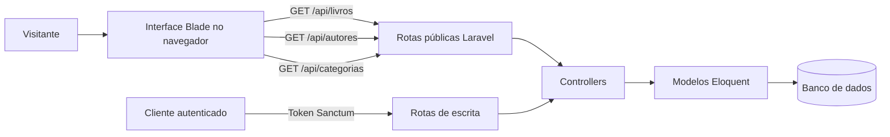

# Biblioteca API — Guia de demonstração

Este documento descreve **o que existe no projeto** e um roteiro para apresentar a aplicação com dados de demonstração. O catálogo de consulta é público; o CRUD de escrita depende de autenticação. Não compartilhe credenciais nem tokens nos exemplos públicos.

## Acesse e experimente

**Interface visual:** https://biblioteca-api-dhaniels1.onrender.com/

1. **Livros:** observe os indicadores, busque por título/autor/ISBN, altere categoria e ordenação e abra os detalhes de uma obra.
2. **Autores:** use o menu lateral para consultar perfis e a quantidade de livros associados.
3. **Categorias:** navegue pelos agrupamentos literários.
4. **JSON:** compare o catálogo visual com os dados retornados em [`GET /api/livros`](https://biblioteca-api-dhaniels1.onrender.com/api/livros). Os retornos de autores e categorias ficam em `/api/autores` e `/api/categorias`.

A primeira visita pode levar mais tempo por causa das condições de hospedagem gratuita. Os quantitativos exibidos são consultados pela API e dependem dos registros atuais — não são números fixos.

## Arquitetura simplificada



A interface de demonstração apenas consulta os dados. Rotas `POST`, `PUT` e `DELETE` exigem autenticação com Laravel Sanctum. O projeto possui testes e uma coleção Postman para verificações controladas da API.

## Endpoints públicos de leitura

| Método | Endpoint | O que retorna |
| --- | --- | --- |
| GET | `/api/livros` | Coleção de livros com relacionamentos `autor` e `categoria` |
| GET | `/api/livros/{id}` | Um livro com seus relacionamentos |
| GET | `/api/autores` | Autores |
| GET | `/api/categorias` | Categorias |

Teste sem credenciais:

```bash
curl -H "Accept: application/json" https://biblioteca-api-dhaniels1.onrender.com/api/livros
```

### Exemplo ilustrativo da estrutura JSON

O trecho abaixo é **esquemático, não uma resposta capturada da produção**. Campos omitidos ou adicionais dependem dos modelos do Laravel.

```json
[
  {
    "idlivro": 1,
    "titulo": "Título demonstrativo",
    "autor": {"idautor": 1, "nome": "Autora exemplo"},
    "categoria": {"idcategoria": 1, "nome": "Categoria exemplo"}
  }
]
```

## Regras e proteção

- `GET` é público para as entidades de catálogo.
- Operações de escrita exigem autenticação via Sanctum.
- Regras de validação estão documentadas no README e nas classes de Request.
- A exclusão de autores/categorias com livros vinculados retorna conflito (`409`).
- Dados de demonstração podem ser inseridos pelo `CatalogoDemoSeeder`, conforme a configuração do ambiente.

## Uma apresentação em cinco minutos

1. Abra o site e explique o problema: organizar livros, autores e categorias.
2. Mostre a busca e os filtros e como a contagem se modifica.
3. Mostre um livro e seus relacionamentos.
4. Abra `/api/livros` e compare a interface com o JSON.
5. Abra o repositório e destaque rotas, Controllers, Eloquent, Sanctum e testes.

## Verificação antes de demonstrar

- [ ] Site e endpoints respondem.
- [ ] Existem registros de demonstração no ambiente.
- [ ] Pesquisa e filtros retornam o esperado.
- [ ] Os links de código/documentação funcionam.
- [ ] Nenhum token ou credencial é exposto em tela.

Repositório: https://github.com/Dhaniels1/biblioteca-api
